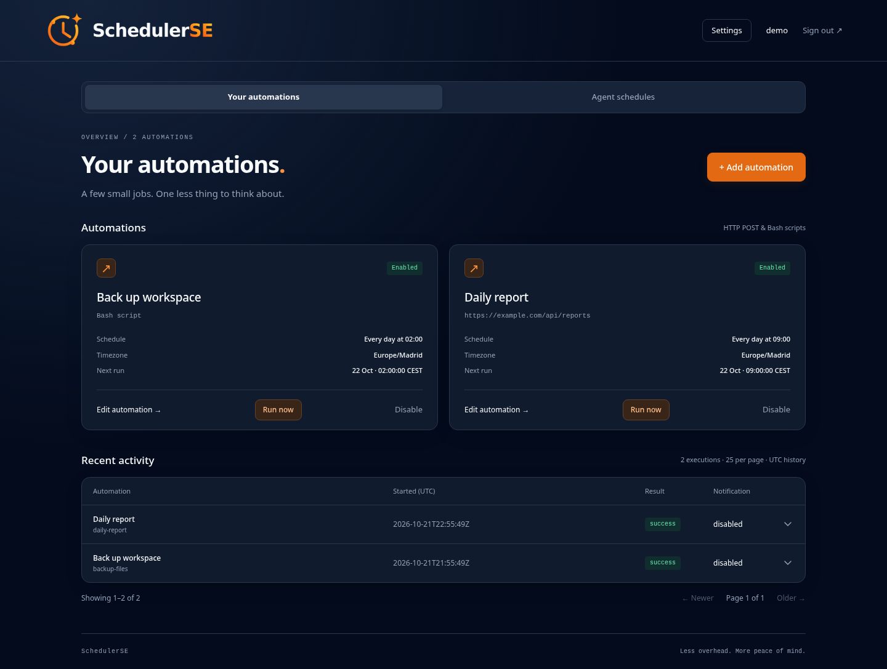

# SchedulerSE

**Give your AI agents reminders, timers and the ability to run automations.**

SchedulerSE gives AI agents a persistent scheduling service for follow-ups, HTTP POST
automations and Bash scripts. Agents can create reminders, schedule recurring work
and start saved automations through the API. Manage everything from an authenticated
web interface, with execution history and detailed Telegram alerts.

<p align="center">
  
</p>

## Features

- **HTTP POST automations** — send JSON payloads with optional authorization, task-specific timeouts, retries and a fallback endpoint.
- **Bash script tasks** — paste a script into the editor and run it on demand or on a schedule. Bash is included in the container and disabled by default.
- **Flexible scheduling** — minute intervals, hourly, daily, weekly, monthly and advanced cron schedules, with a timezone for each task.
- **Manual execution** — start saved tasks with **Run now**, with protection against duplicate submissions and overlapping runs.
- **Telegram alerts** — choose success, failure and fallback notifications.
- **Execution history** — inspect past runs, HTTP statuses, errors, task revisions and notification delivery.
- **MCP integration** — give agents discoverable tools for timers, reminders, HTTP POST and Bash automations, including setup guidance and access to the standalone reminder bridge.

## Quick start

With Docker Engine and Docker Compose installed:

```sh
git clone https://github.com/fixtse/SchedulerSE.git
cd SchedulerSE
```

Start the service using the prebuilt image:

```sh
docker compose pull
docker compose up -d --wait
```

Open **http://127.0.0.1:8789**. For a remote server, forward the port over SSH:

```sh
ssh -L 8789:127.0.0.1:8789 your-server
```

Generate the one-time setup token and use it to create your administrator account:

```sh
docker compose exec schedulerse /app/schedulerse setup-token
```

Usernames accept 3–64 letters, digits, dots, underscores or hyphens. Passwords accept
12–72 bytes. You can now create your first automation and configure Telegram in settings.

## Create an automation

Choose a task type in the editor, add its settings, then select a schedule. New tasks
start with scheduled execution disabled; enable them when ready. **Run now** executes
the saved task immediately, including tasks with scheduling disabled. Save edits before
running, then check **Recent activity** for the result.

### HTTP POST

Enter an endpoint URL, a JSON object and an optional authorization header. Use the
complete header value, such as `Bearer …`. JSON values retain their original types.
Leave a saved authorization field blank to keep its current value. Changing an
endpoint origin requires clearing or replacing its saved authorization header;
this also applies to fallback endpoints and reminder webhooks.

Set an **Execution timeout** of 100–600000 milliseconds, or leave it blank to inherit
the default in **General settings** (initially 120000). The timeout applies separately to each attempt,
including reading the response body.

For endpoints that safely accept repeated requests, configure recovery:

- **Retries after failure:** 0–5 extra attempts after HTTP 429 or 5xx responses.
- **Delay between retries:** 100–60000 milliseconds; blank uses 1000.
- **Fallback endpoint:** send the same JSON body once after eligible primary failures
  and exhausted retries. Configure its authorization header separately.
- **Also recover after uncertain results:** extend recovery to timeouts, network errors,
  redirects and unreadable responses. The original request may already have completed,
  so enable this only when repeated execution is safe.

A successful fallback is recorded as a fallback result and uses the corresponding
Telegram notification preference. A failed fallback is recorded as a failure.

### Bash scripts

Bash is **disabled by default**, including existing saved scripts. HTTP automations
and reminders continue to work. Use HTTP POST tasks when your work needs a network
request.

Administrators may set `ENABLE_BASH=true` to enable isolated scripts, then separately
set `ENABLE_AGENT_BASH=true` to allow agents to create or run them. Both flags are
strict booleans and require a restart. In Compose, edit the explicit values under
`environment`; an `.env` value does not override those entries.

Enabling Bash requires Linux, `bubblewrap`, `prlimit`, working unprivileged user/PID/
network namespaces, and cgroup v2 limits of at most 512 MiB memory, 128 PIDs, and one
CPU core. These tools are included in the image. The service checks the resource
limits and runs a sandbox probe at startup; unsupported isolation fails closed.
Standard Docker security policies may block nested namespaces. Keep Bash disabled
on those hosts; do not add privileged mode, host mounts, the Docker socket, or broad
capabilities to bypass the check. Native services need equivalent external cgroup
limits, for example systemd `MemoryMax=512M`, `MemorySwapMax=0`, `TasksMax=128`, and `CPUQuota=100%`.

Scripts run with `bash -e -o pipefail` in fresh namespaces with an empty environment
apart from `PATH` and `HOME`. They have no network access, scheduler data, home
directory, credentials, or persistent output. System commands and libraries are
mounted read-only. `/tmp` is private and limited to 16 MiB; every file is discarded
when the run ends. Existing scripts that use `/data`, inherited environment values,
or network commands must be rewritten; there is no unsafe compatibility fallback.

```bash
printf '%s\n' '{"message":"Hello from SchedulerSE"}' > /tmp/message.json
jq -e '.message | length > 0' /tmp/message.json > /dev/null
```

Each run has its own PID namespace. Completion or timeout destroys its descendants,
including detached processes. Process limits cap address space at 256 MiB, CPU time
at 30 seconds per process, file size at 16 MiB, open files at 128, and processes at
64 per sandbox user namespace. The execution timeout is also enforced, initially
120 seconds and at most 600 seconds. Output is discarded; exit zero records success,
a nonzero exit records `SCRIPT_FAILED`, and timeout records `SCRIPT_ABORTED`.
HTTP retries and fallback are disabled for scripts.

The scheduler admits at most four simultaneous executions. When capacity is full,
manual requests are rejected and scheduled occurrences are skipped rather than
queued or replayed. Compose also limits the
whole service to 512 MiB memory, one CPU, 128 PIDs and rotating logs. Scripts share
this aggregate budget with the scheduler, so resource abuse can still interrupt
service availability; this is not a multi-tenant compute service. Keep enabled
agent clients trusted and give them only the tools they need.

Storage is bounded: 1,000 automation jobs, 1,000 reminder records, 100,000 execution
records and 100,000 pickup receipts. SQLite growth is capped at 32,768 pages
(normally 128 MiB). Capacity exhaustion rejects new work. Records are not silently
deleted because that would weaken idempotency; monitor capacity and archive state
during administrator-controlled maintenance.

### Schedules and timezones

Choose **Manual only**, **Every few minutes**, **Hourly**, **Daily**, **Weekly** or
**Monthly**. Weekly schedules support multiple weekdays. **Advanced cron** accepts
five fields, or six including seconds.

Each task follows its selected timezone, with **General settings** providing the default. Next-run
times appear in the task's timezone; history timestamps use UTC. Daylight-saving
changes follow local clock time: skipped times are skipped, and repeated times can
run twice. Monthly schedules skip months without the selected day.

## Telegram notifications

Open **Telegram settings**, enter your bot token from @BotFather and a destination
chat ID or public channel `@username`, then enable notifications and save. Start a
conversation with the bot or grant it permission to send messages to your group or
channel. Use **Test Telegram** to verify the saved connection; allow 10 seconds between tests.

Choose the events you want to receive:

- **Failures and timeouts**
- **Successful completions**
- **Fallback warnings**

## Execution history

**Recent activity** shows 25 runs per page. Expand a row to inspect its trigger,
start and finish times, duration, HTTP status, error code, timeout, task revision,
attempt count, fallback use and Telegram delivery result. Each record captures the
task identity and execution settings used for that run.

Use **Newer** and **Older** to browse previous executions. Older records remain
available across upgrades; fields introduced after a run appear as **Not recorded**.

## Agent timers and reminders

Use the **Agent schedules** tab for timers, reminders and recurring agent tasks.
The built-in MCP server provides structured tools for creating, inspecting and
cancelling reminders, configuring delivery, and creating or running HTTP POST and
Bash automations. The REST API remains available at `/api/agent/v1`.
The shared token manages installation-wide HTTP automations and reminder delivery.
Bash requires separate administrator opt-in and runs only in the offline sandbox.
Give tokens only to trusted agents; HTTP automations can reach the service network.

### Connect an agent

1. Open **Agent API settings** and add its MCP server URL to your agent’s client.
   Use **Streamable HTTP** at `https://your-server/api/agent/v1/mcp`.
2. Generate a token and store it privately in the client’s connection settings as
   `Authorization: Bearer <token>`. Choose a client that supports remote HTTP
   connections with bearer headers.
3. Ask the agent to configure reminder delivery and verify a test reminder. The agent
   can read setup guides and fetch bridge files directly through MCP.
   A standalone **delivery kit** is also available for manual installation.

MCP exposes `create_timer`, `create_reminder`, `list_schedules`, `get_schedule`,
`cancel_schedule`, `create_automation`, `list_automations`, `get_automation`,
`run_automation`, `list_runs`, `get_connection`, `configure_connection`, `get_guide`
and `get_delivery_file`.
Execution tools return acceptance; use `list_runs` to inspect completion. Token
replacement or revocation applies immediately to MCP and REST requests.

For reminder delivery, keep the bundled Python bridge running beside the agent under
a process supervisor, with persistent state, or configure a reachable webhook receiver.

The bridge polls for due reminders, saves durable receipts and invokes Codex or the
configured agent adapter. Install the agent runtime and its credentials alongside
the bridge. On the Compose network, the service address is
`http://schedulerse:8789`; a bridge on the host uses the published service address.
See the [local setup guide](internal/agentkit/schedulerse-delivery/references/local.md).

For remote integrations, choose **Webhook** delivery. For reminders delivered into a
T3 thread, use its native webhook integration when reachable. Further setup is covered
in the [T3 guide](internal/agentkit/schedulerse-delivery/references/t3.md) and
[Cloudflare inbox guide](internal/agentkit/schedulerse-delivery/references/cloudflare.md).
The Agent API settings page also provides a downloadable API reference.

### Create a timer

```http
POST /api/agent/v1/tasks
Authorization: Bearer <generated-token>
Content-Type: application/json

{"id":"tea-timer-001","kind":"timer","title":"Tea is ready","after_seconds":180,"context":{"conversation_id":"chat-123"}}
```

Use `run_at` with an RFC3339 timestamp and explicit offset for a particular time.
Add `interval_seconds` for recurring delivery, with a minimum interval of 60 seconds.
Use stable task IDs and inspect `GET /api/agent/v1/tasks/{id}` before retrying an
uncertain creation request.

### Delivery behavior

Each due occurrence produces a `schedule.due` event with a stable `event_id`, scheduled
time, message and original `context`.

- **Local polling:** `context.conversation_id` matches the bridge's routing label.
  The bridge saves an occurrence before acknowledging it, using a stable consumer ID.
  Due reminders wait while the bridge is offline.
- **Webhooks:** the receiver durably accepts the event and returns 2xx within
  10 seconds. Delivery is attempted once; failed webhook recurrences stop. Callbacks
  interrupted by a restart are marked `interrupted` for review.

Delivery status records acceptance by the bridge or receiver. Review the agent's
own results for completion. Recurrence advances after pickup or a successful callback,
skipping missed slots. Local invocation failures remain in bridge receipts while
future recurring pickups continue.

Pending schedules persist across restarts and delivery-mode changes. Token revocation
stops polling access; cancel pending schedules separately to stop their future delivery.
Each installation shares one agent token and delivery mode. Use HTTPS for remote API
and webhook connections.

## Settings

Open **General settings** to choose your default timezone and execution timeout.
Tasks can override either value. Under **Advanced options**, enable **Use secure
cookies** when accessing SchedulerSE over HTTPS. Changes apply immediately and are
saved with your account and task data.

Use the tabs on **Settings** to manage **General** defaults, **Telegram** notifications and **Agent API** connections. Compose uses
port `8789`, the `schedulerse_state` volume and the published `latest` image.
For an HTTPS reverse proxy, preserve the original `Host` header and exclude
`/health` from proxying. Keep credentials and state backups private.

## Updates and backups

Pull the selected image and recreate the service:

```sh
docker compose pull
docker compose up -d --wait
docker compose logs --tail 50 schedulerse
```

## License

[MIT](LICENSE)

### Authentication behind a reverse proxy

Login/reset verification is limited per client address rather than globally.
Forwarded headers are ignored unless the peer is in `TRUSTED_PROXY_CIDRS`, a
comma-separated list of explicit proxy network CIDRs. Configure only the actual
proxy addresses, ensure the proxy sanitizes forwarded headers, and block direct
access to the backend. The server walks `X-Forwarded-For` from right to left until
it reaches an untrusted hop. Leave this setting empty for direct connections.
Enable secure cookies in General settings when serving through HTTPS.
